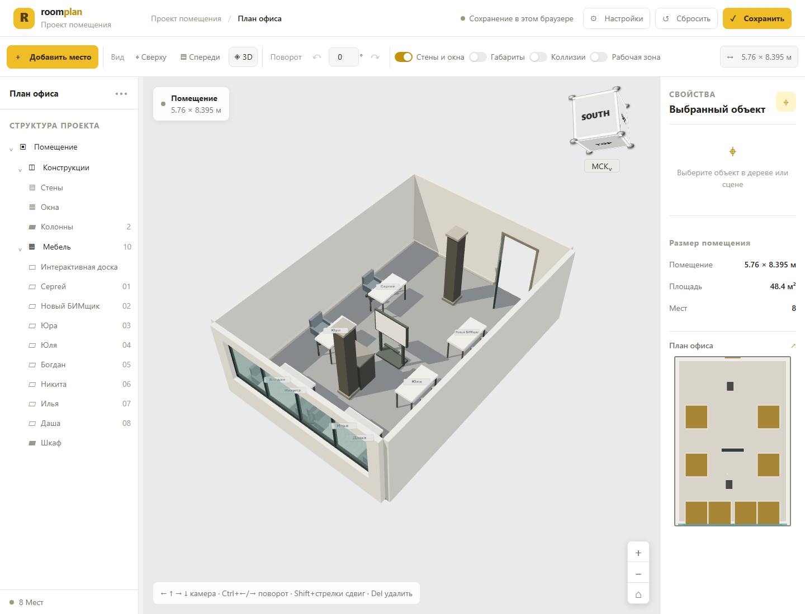
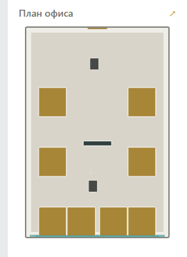

# Room Constructor

Room Constructor is a browser based 3D office layout editor. It lets a small team inspect the supplied office plan as a three dimensional room and try different arrangements of desks and the interactive board.

The application currently runs entirely in the browser. It does not require a .NET service, database, or account. The room shell and its measurements are defined in the project; layout preferences and object positions are saved in the current browser's local storage.

## Screenshots



The side plan keeps the real 5.76 m × 8.395 m room proportions. Its desk and chair marks, columns, interactive board, cabinet, glazing, and doorway are placed from their scene coordinates and dimensions.



## What you can do

- Inspect the office in a rotatable, zoomable 3D scene. Use the AutoCAD style view cube to choose a face or corner; the cube follows the camera and view changes animate smoothly.
- Open a local **GLB, glTF, OBJ, or STL** model from the scene toolbar. Files are read in the browser and are not uploaded; glTF files that reference separate assets must be selected together with those assets.
- Move workstations, the interactive board, and the cabinet by dragging them in the scene. A workstation includes its desk and chair, so they move and rotate together.
- Select an object in the project tree to highlight it in the scene; hover over objects in the scene to preview the same highlight.
- Use keyboard shortcuts for camera orbit, object movement and rotation, zoom, saving, and removing the selected workstation. The full list is available in **Settings**, with a compact hint at the bottom of the scene.
- Add or remove workstations, rename their occupants, change their positions, and rotate selected movable objects from the scene toolbar or properties panel.
- Show object dimensions and collision footprints. Overlapping objects and objects outside the room are highlighted in red.
- Toggle the room walls and windows, and optionally highlight the work area.
- Browse room elements in the project tree. Clicking a movable object selects and highlights it in the scene. Drag the divider beside the tree to resize the panel; its width is remembered in the browser.
- Switch between Russian and English, and between light and dark interface themes in **Settings**.
- Keep the room plan visible while experimenting. The current room model is 5.76 m × 8.395 m, with a 2.8 m wall height. It includes the short end wall glazing, the opposite end entrance, structural columns, movable cabinet, carpet, and the initial workstations based on the supplied drawings.
- Use the editor on a phone in landscape orientation. The scene fills the screen, supports touch camera gestures, and the scene toolbar can be scrolled horizontally.

## Requirements

- Windows, macOS, or Linux.
- Node.js **20.19 or newer in the 20.x line**, or **22.12 or newer**. These versions are required by the Vite version used by the project.
- A current browser with WebGL enabled (for example, Chrome, Edge, or Firefox).
- An internet connection the first time dependencies are installed.

Visual Studio Code is optional. The repository includes a launch profile for users who prefer to start the app with **F5**.

## Run it for the first time

1. Install Node.js from [nodejs.org](https://nodejs.org/) if it is not already installed. On Windows, choose the LTS release and keep the option to add Node.js to `PATH` enabled.
2. Open the `RoomConstructor` project folder in Visual Studio Code, or open a terminal in that folder.
3. Install the locked project dependencies once:

   ```powershell
   npm ci
   ```

4. Start the application:

   ```powershell
   npm run dev
   ```

5. Open the local address printed in the terminal, usually `http://localhost:5173/`.

The development server stays open in the terminal. To stop it, focus that terminal and press **Ctrl+C**.

### Start with F5 in Visual Studio Code

Open the project folder in VS Code, choose **Room Constructor — запуск** in the Run and Debug panel, then press **F5**. The included launch profile starts the Vite server and opens the local address in your default browser. If dependencies are missing, VS Code runs the project setup task first.

## Build a production version

To create an optimized static build:

```powershell
npm ci
npm run build
```

The generated site is written to `dist/`. To inspect that build locally, run:

```powershell
npm run preview
```

Then open the address printed by Vite Preview. The `dist/` folder is generated output and is intentionally excluded from Git; deploy its contents to any static web host that can serve a single-page application.

## Using the editor

- **Rotate the scene:** drag on empty scene space. Scroll to zoom, or use the plus and minus controls. Click a face or corner on the view cube to animate to that view.
- **Move an object:** drag a desk or the interactive board. Select it in the scene or project tree to edit its name, coordinates, or rotation.
- **Add a workstation:** click **Add workspace**. Select the new item to rename it or remove it.
- **Show measurements and conflicts:** turn on **Dimensions** or **Collisions** in the scene toolbar. A selected movable object displays its measured footprint; collision outlines show available and conflicting space.
- **Change the room display:** use **Walls and windows** and **Work area** in the toolbar. Use **Settings** for language and theme.
- **Restore the original layout:** click **Reset** and confirm. This resets workstation and board positions to the default plan layout while retaining occupant names where possible.
- **Save:** layout changes are stored in this browser automatically; the Save button gives a confirmation. Browser data is local to that browser profile and is not shared with other computers.

### Keyboard shortcuts

| Shortcut | Action |
| --- | --- |
| Arrow keys | Orbit the camera around the room |
| `Ctrl` + Left/Right | Rotate the selected movable object by 15° |
| `Shift` + Arrow keys | Move the selected movable object by 10 cm |
| `Delete` | Remove the selected workstation |
| `+` / `-` | Zoom in or out |
| `Home` | Return to the default 3D view |
| `Ctrl` + `S` | Save the current plan |
| `Ctrl` + `Z` | Undo the last workstation, board, or cabinet change |
| `Ctrl` + `Y` | Redo the undone workstation, board, or cabinet change |
| `Esc` | Close Settings or clear the current selection |

Undo and redo cover moves, rotations, additions, removals, and renames. The history is kept in memory for the current page session. The same shortcut list is available in **Settings** in both supported interface languages.

## Project structure

```text
RoomConstructor/
├── docs/                 # Reference room images and drawings
├── src/
│   ├── main.js           # UI, room geometry, editor controls, and persistence
│   └── style.css         # Responsive light and dark themes
├── .vscode/              # F5 launch profile and setup task
├── index.html            # Application entry point
├── package.json          # Scripts and dependencies
└── package-lock.json     # Reproducible dependency versions
```

## Troubleshooting

- **`npm` is not recognized:** install Node.js, close and reopen VS Code, then check `node --version` and `npm --version` in a new terminal.
- **The browser does not open with F5:** make sure the `Room Constructor — запуск` profile is selected. You can still run `npm run dev` manually and open the URL printed in the terminal.
- **The page is blank or the scene is missing:** update the browser and enable hardware acceleration/WebGL. Check the browser console for graphics driver errors.
- **The layout looks old or is missing recent changes:** reload the page. Saved object positions belong to the current browser profile; use **Reset** to restore the project defaults.
- **Dependency installation fails:** check the Node.js version and network connection, then run `npm ci` again from the project folder.

## Current scope

This version is a local planning tool. It does not yet synchronize layouts between users or store plans on a server. Because the layout is stored in browser local storage, clearing site data for the local application also clears the saved layout.

Direct **Revit (`.rvt`) and AutoCAD (`.dwg`)** viewing is not included. Those proprietary formats need a CAD/BIM translation service such as Autodesk Platform Services; that requires a server to keep API credentials private and sends selected files to the provider for translation. Export a model to GLB, glTF, OBJ, or STL to view it locally in this version.
